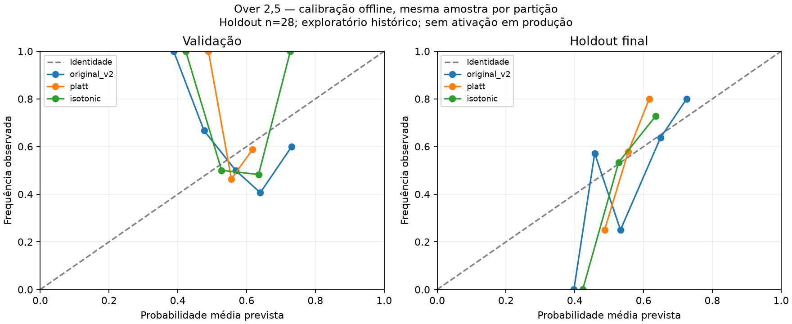

# Calibração Over 2,5 — estudo offline de 13/11/2026

Protocolo `MC-CAL-O25-20261113-v1`. **Exploratório histórico. Calibração em produção: desligada.**

Universo: 933 probabilidades congeladas com a primeira odd válida, sem reconstrução de snapshots. Baseline: taxa do treino 0.5535; baseline adicional 0,5.
Treino 607, validação 76, holdout final 28; 222 observações removidas pelo embargo de 48h. Seleção na validação: **isotonic**. Coeficientes exclusivamente do treino, sem refit.

| Modelo | Validação Brier | Holdout Brier (IC95% por dia) | Log Loss | Skill vs treino | ECE | ΔBrier pareado IC95% |
|---|---:|---|---:|---:|---:|---|
| original_v2 | 0.27506 | 0.22612 [0.18483, 0.33905] | 0.64304 | +7.79% | 0.10139 | [0.00000, 0.00000] |
| platt | 0.25712 | 0.23400 [0.21020, 0.29610] | 0.66067 | +4.58% | 0.08236 | [-0.04517, 0.02560] |
| isotonic | 0.25562 | 0.22741 [0.20204, 0.30395] | 0.64721 | +7.26% | 0.06970 | [-0.05289, 0.01971] |

## Fiabilidade no holdout (mesma amostra por modelo)

| Modelo | Faixa | n | Probabilidade média | Frequência (Wilson IC95%) |
|---|---|---:|---:|---|
| original_v2 | 0%–40% | 1 | 39.8% | 0.0% [0.00000, 0.79345] |
| original_v2 | 40%–50% | 7 | 45.8% | 57.1% [0.25046, 0.84178] |
| original_v2 | 50%–60% | 4 | 53.3% | 25.0% [0.04559, 0.69936] |
| original_v2 | 60%–70% | 11 | 64.9% | 63.6% [0.35380, 0.84834] |
| original_v2 | 70%–80% | 5 | 72.5% | 80.0% [0.37553, 0.96378] |
| platt | 40%–50% | 4 | 48.7% | 25.0% [0.04559, 0.69936] |
| platt | 50%–60% | 19 | 55.6% | 57.9% [0.36276, 0.76858] |
| platt | 60%–70% | 5 | 61.7% | 80.0% [0.37553, 0.96378] |
| isotonic | 40%–50% | 2 | 42.3% | 0.0% [0.00000, 0.65762] |
| isotonic | 50%–60% | 15 | 52.7% | 53.3% [0.30117, 0.75190] |
| isotonic | 60%–70% | 11 | 63.5% | 72.7% [0.43435, 0.90254] |

## Estabilidade temporal do holdout

| Modelo | Semana UTC | n | Brier | Log Loss |
|---|---|---:|---:|---:|
| original_v2 | 2026-W46 | 28 | 0.22612 | 0.64304 |
| platt | 2026-W46 | 28 | 0.23400 | 0.66067 |
| isotonic | 2026-W46 | 28 | 0.22741 | 0.64721 |

## Limitações e parecer

- Not a pristine independent holdout: aggregate historical outcomes were already inspected.
- Odds-covered v2 subset differs from complete v2 history; do not compare as identical universes.
- Legacy settlement time and frozen model version absent; legacy v2 label comes from predictions, explicitly inferred.
- 48h outcome maturity is a retrospective assumption, not proof of actual data availability.
- Day bootstrap assumes exchangeable days and does not fully model league/time dependence.
- Small final partition and short period cannot justify production activation.

Não ativar a calibração. Uma melhoria retrospectiva exige confirmação futura com protocolo registado antes da recolha; não demonstra vantagem económica.

Reprodução: `python -m analysis.calibration_study --db predictions.db --output research/results_2026-11 --plot`. Os JSON incluem IDs exatos, períodos, parâmetros, curvas, métricas e hashes.
